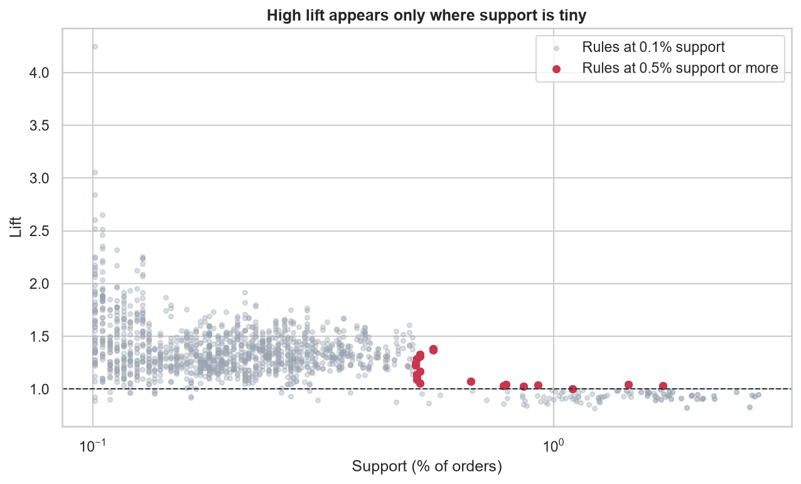
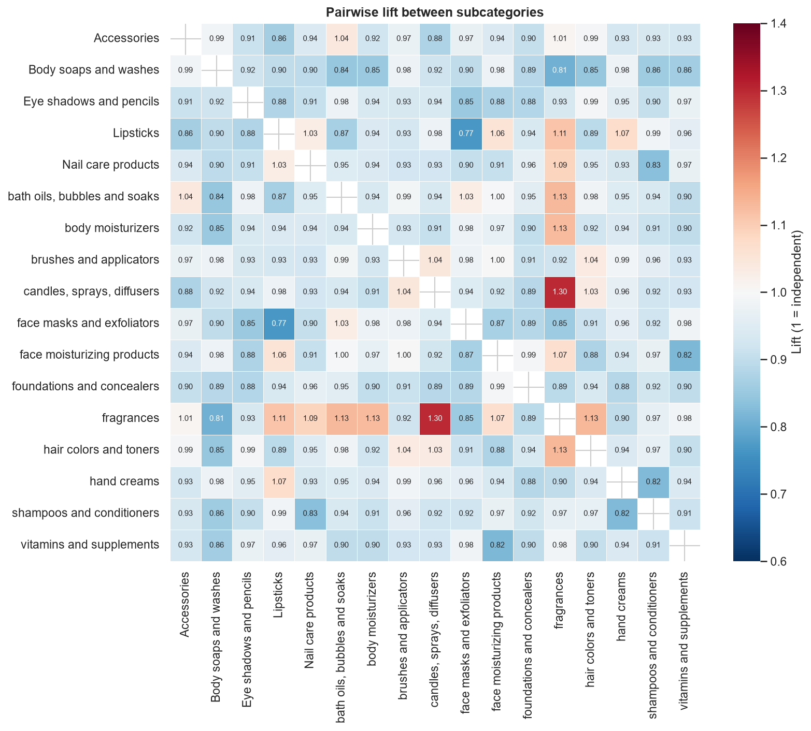

# Market Basket Analysis: What Sells Together?

[](https://github.com/Haven-Pham/market-basket-analysis/actions/workflows/ci.yml)


## Overview

A merchandising team wants evidence for product bundles and "frequently bought together" recommendations. This
project analyses 25,728 orders (51,290 order lines) from a beauty and home-care e-commerce retailer at subcategory
level. It uses two methods, a self-join co-occurrence count and the Apriori algorithm, and tests whether the
associations found are real or produced by chance.

**Summary of results.** Associations between subcategories are weak. The most frequent pairs all have a lift below 1.
The rules with lift above 2 each rest on fewer than 30 orders. When every rule must be backed by at least 0.5% of
orders (about 130 orders), the strongest lift is 1.38. Half of all orders (52.1%) contain a single subcategory, so
the larger commercial opportunity is basket size rather than any particular bundle.



## Business Questions

1. Which subcategories are bought in the same order?
2. Are those combinations stronger than chance, or simply the result of popular items?
3. Which recommendations does the evidence support?

## Approach

- **Data preparation.** Two product codes with a tripled prefix (`PPP000002`) were corrected so that every order
  line joins to its product. The analysis works on 17 subcategories, because individual products are too numerous and
  too rarely repeated.
- **Method 1: self-join.** The order table is joined to itself on `OrderID` to count every co-purchased pair, with
  support, confidence in both directions, and lift.
- **Method 2: Apriori.** `mlxtend` mines frequent itemsets and association rules at two support thresholds (0.1% and
  0.5%) so that the rules can be compared.
- **Robustness check.** Lift is plotted against support to show where high-lift rules come from.

## Key Findings

| Measure | Result |
|---|---|
| Orders with a single subcategory | 52.1% |
| Most common subcategory | Nail care products, in 19.9% of orders |
| Lift of the most frequent pairs | 0.83–0.97 (they appear together slightly less often than chance) |
| Highest pairwise lift | 1.30, candles + fragrances (62 orders) |
| Highest lift, rules with ≥ 0.1% support | about 4.2, backed by about 26 orders |
| Highest lift, rules with ≥ 0.5% support | 1.38, bath oils + body moisturisers → nail care (141 orders) |



## Recommendations

1. **Grow basket size first.** Generic cross-sell prompts, free-shipping thresholds and multi-buy offers address the
   52% of single-item orders.
2. **Use popular body-care items as default recommendations** for their reach, and target the mild three-item
   body-care affinity (lift 1.3–1.4) where a bundle is wanted.
3. **A/B-test any bundle** against a control and measure the uplift in average order value before changing the
   catalogue.
4. **Do not build bundles on high-lift, low-support rules.** They are most likely chance patterns.

## Repository Structure

```text
market-basket-analysis/
├── data/                    EcomSales.csv, Product.csv and data dictionary
├── notebooks/               market_basket_analysis.ipynb (analysis with outputs)
├── reports/
│   ├── figures/             basket size, top pairs, lift heatmap, support vs lift
│   └── tables/              subcategory pairs and robust rules (CSV)
├── scripts/run_notebook.py  re-executes the notebook
└── requirements.txt
```

## Reproducing the Analysis

```bash
pip install -r requirements.txt
python scripts/run_notebook.py
```

## Data

Synthetic, educational e-commerce data; they do not describe a real company or real customers. Field definitions
are in [`data/README.md`](data/README.md).

## Limitations

- The data are synthetic, so the weak associations may reflect how they were generated.
- Product-level associations would need many more orders per product to measure.
- Association does not prove causation; only a controlled test shows whether a recommendation changes behaviour.

## Author

Pham Hong Hieu (Haven) · [Portfolio](https://haven-portfolio02.vercel.app) · [LinkedIn](https://www.linkedin.com/in/havenpham) · [GitHub](https://github.com/Haven-Pham)
